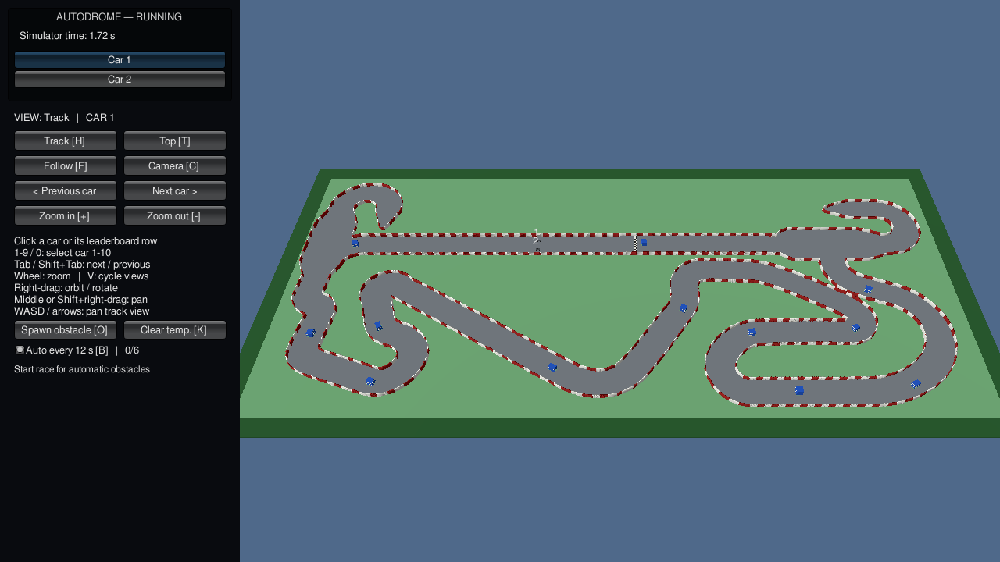
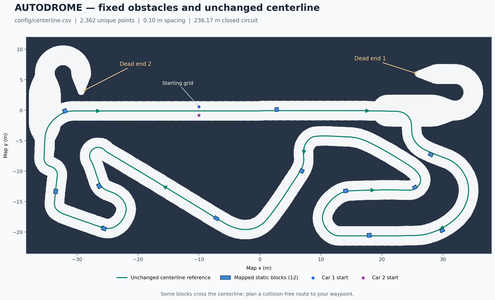
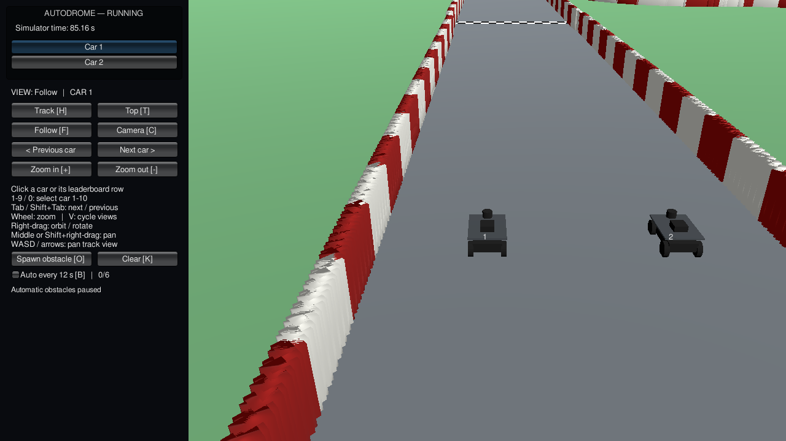
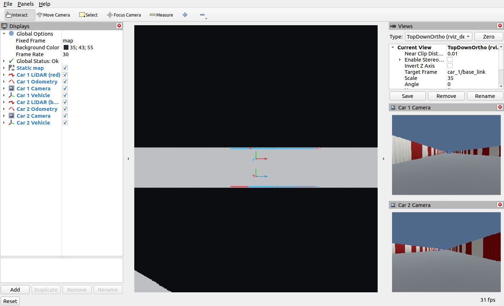

# AUTODROME: Autonomous Racing — A Culminating Robotics Assignment

***Build an autonomous driving system that completes a full lap as quickly as possible while avoiding collisions. Each submission controls one assigned car in a two-car race.***

### How to get started →

Read this entire write-up before implementing your system. Identify the data you receive, the coordinate frames in which those data are expressed, and the decisions your software must make. Plan how you will test each module before integrating the complete system.

The AUTODROME student kit provides the simulation environment. This document defines the full-lap course assignment and includes the simulator instructions needed to complete it. Selecting and reaching a centerline waypoint is one step in a repeating process that must take your car around the entire circuit.

---

## Introduction

An autonomous robot must connect what it observes to what it does. Sensor measurements describe the nearby environment; a state estimate describes the robot's position and motion; a map provides spatial context; a planner chooses a feasible route; and a controller turns that route into physical motion. These components must agree about coordinates, timing, vehicle capabilities, and the meaning of an obstacle. A failure at any interface can prevent an otherwise correct algorithm from working.

In this culminating course assignment, you will integrate the robotics concepts learned throughout the course into an autonomous racing system. Your car will race against another car on a shared Catalunya-inspired circuit. The environment contains fixed obstacles represented in an occupancy map, dead-end detours, and additional obstacles that appear during the run. You will receive an offline centerline, sensor observations, odometry, and coordinate transforms. Your task is to use these inputs to decide where to go, how to get there, and how fast to travel.

Racing makes the trade-offs measurable. A higher speed can reduce lap time but also reduces reaction time, increases braking distance, and makes tracking errors more costly. A longer planning horizon can improve route selection but requires more computation. A local avoidance maneuver may prevent a collision while moving the car away from its global plan. Your system must manage these interactions continuously.

The objective is **a fast, complete, collision-free lap**. You are free to choose the algorithms and architecture, but your design must perform the required perception, state interpretation, occupancy-map planning, local avoidance, and control functions. Your report must explain these choices and support them with experimental evidence.



### Example race

These three GIFs show the **same full two-car race at 4× playback speed**. Both cars completed the lap without collisions. Matching timestamps identify corresponding moments across the views; separate GIF viewers may begin playback at different times.

**Car 1 camera view**


**Car 2 camera view**


**Zoomed top view following both cars**


---

## Assignment Information

### Learning objectives

By completing this assignment, you should be able to:

1. **Integrate a complete robotics pipeline.** Connect sensing, state estimation inputs, coordinate transforms, mapping representations, planning, and feedback control in a working ROS 2 system.
2. **Interpret sensor observations.** Process either LiDAR scans or camera images into information useful for collision avoidance, accounting for sensor range, calibration, invalid readings, and visibility limitations.
3. **Use state estimates and reference frames correctly.** Combine the provided odometry and TF information to express the car, observations, goals, and plans in consistent frames at appropriate timestamps.
4. **Plan in an occupancy map.** Convert between map coordinates and grid cells, account for the vehicle footprint and clearance, and generate routes around mapped obstacles.
5. **Make decisions over multiple horizons.** Select centerline goals that advance the car around the circuit, then coordinate global planning with local responses to newly observed obstacles.
6. **Respect vehicle motion constraints.** Relate Ackermann steering, turning radius, speed, braking distance, and command-rate limits to the feasibility of a planned path.
7. **Design and tune feedback control.** Track a planned route, regulate speed, and balance lap time against tracking accuracy and collision risk.
8. **Evaluate a complete system experimentally.** Measure completion rate, valid lap time, collisions, tracking error, and computation time; use failure cases and comparisons to justify improvements.
9. **Produce reproducible robotics software.** Provide a configurable ROS 2 package, clear launch instructions, documented dependencies, and evidence that another person can reproduce your results.

### The task

Implement an autonomous system that repeatedly:

1. Obtains the assigned car's current pose and motion from the provided state information.
2. Processes camera or LiDAR observations to identify nearby obstacles and usable space.
3. Selects a suitable point ahead on the supplied centerline as its current goal.
4. Plans a global path to that point **in the occupancy map**, aligning poses and observations with the map when needed.
5. Tracks the global path while a local planner/controller avoids the other car and dynamically spawned obstacles.
6. Updates its goal, plan, and commands as needed until it has completed a full lap.

You determine the goal-selection strategy, planning horizons, replanning conditions, controller design, and operating speed and steering limits. The chosen operating limits must fit within the simulator's vehicle capabilities described later in this document.

### Algorithm choice

No particular planning or control algorithm is prescribed. The following are examples, not a required combination:

| Function | Examples | What your implementation must accomplish |
| --- | --- | --- |
| Perception | LiDAR processing, camera-based obstacle/free-space detection, or a combination | Use live observations to support collision avoidance |
| Global planning | A*, Dijkstra, RRT, or another suitable method | Find a feasible route to the selected goal using occupancy-map information |
| Local planning / avoidance | Follow-the-Gap, local RRT, trajectory sampling, optimization, or another suitable method | Respond to nearby obstacles while maintaining progress toward the global route |
| Tracking and speed control | PID, Pure Pursuit, MPC, or another suitable method | Produce forward-speed and steering-angle commands that track the route within vehicle limits |

One algorithm may perform more than one function. For example, an optimization-based controller may combine local trajectory generation and tracking. You may use one ROS node or several; the required functions and their interfaces must be clear in your implementation and report.

### Requirements

- Complete one full lap of the main circuit autonomously, in the direction indicated by increasing centerline row order.
- Use **camera or LiDAR data** for perception. Using both is allowed but not required.
- Use the provided odometry and transforms to interpret the car's state in the appropriate frame.
- Perform global route planning using `/map`. The supplied centerline is a source of reference goals; it is not a substitute for occupancy-map planning.
- Account for fixed obstacles, the car's footprint, and feasible turning behavior when planning.
- Use a local planner/controller that responds to the other car and dynamically spawned obstacles while following the global plan.
- Support assignment to either car 1 or car 2 without rewriting the algorithm. Make the car number a documented launch argument or parameter.
- Publish commands only to the assigned car's `/car_N/drive` topic, using `ackermann_msgs/msg/AckermannDriveStamped`.
- Handle missing or stale inputs, unavailable transforms, failed plans, and blocked routes deliberately. Stop or slow down when continuing safely is not possible.
- Keep the supplied environment, map, centerline, obstacles, and common vehicle configuration intact for assessment. Tune your own algorithm and operating limits.
- Provide a reproducible launch procedure and evidence of testing. During a judged run, driving decisions must come from your autonomous system.

### Submission Requirements:

- The autonomous racing controller package should be named `autodrome_driver_group_<group_number>`, replacing `<group_number>` with your group number.
- The package should have a launch file named `drive.launch.py` configured to run all the require nodes, i.e., the only file that will be run for evaluation
- The launch should take a launch argument `car_no`, set to `1` or `2`, to select the car that the code controls. For example, group 1 controlling car 1 is launched with `ros2 launch autodrome_driver_group_1 drive.launch.py car_no:=1`.
- Create the package at `~/AUTODROME_Driver/autodrome_driver_group_<group_number>/`, with `package.xml` at the package root, but do not include any other build/install/logs or auxilliary folders/files

### What we provide

| Provided component | Purpose |
| --- | --- |
| Compiled Unity simulator | Shared vehicle physics, steering, collisions, and visualization |
| Two independently controlled cars | One assigned vehicle per competing submission |
| `/map` | Static occupancy map, including track boundaries, dead ends, and 12 fixed obstacles |
| `config/centerline.csv` | Ordered reference points around the main circuit |
| Camera and LiDAR topics | Live observations of walls, fixed obstacles, temporary obstacles, and the other car |
| Odometry and TF | Vehicle pose and velocity information and transforms between relevant frames |
| `/clock` | Simulation time for timestamped processing and timing measurements |
| Vehicle parameters and status | Vehicle capabilities, command timeout state, and collision counts |
| `start_simulation.sh` and RViz configuration | A single launcher for the simulator, interfaces, and visualization |

The simulator supplies the state estimate used in this assignment: odometry is derived from simulator ground truth. You must use that information correctly, but implementing a new localization system, SLAM system, or sensor-fusion estimator is not required. An additional estimator is optional if it serves a clear purpose in your design.


### Resources

Review the course material on sensing and calibration, rigid-body transforms, state estimation, occupancy grids, graph and sampling-based planning, vehicle kinematics, and feedback control. The following references support the simulator interfaces:

- [ROS 2 Humble: introduction to TF2](https://github.com/ros2/ros2_documentation/blob/humble/source/Tutorials/Intermediate/Tf2/Introduction-To-Tf2.rst).
- [ROS 2 Humble: Quality of Service settings](https://github.com/ros2/ros2_documentation/blob/humble/source/Concepts/Intermediate/About-Quality-of-Service-Settings.rst).
- [OccupancyGrid message definition](https://github.com/ros2/common_interfaces/blob/humble/nav_msgs/msg/OccupancyGrid.msg) and [Odometry message definition](https://github.com/ros2/common_interfaces/blob/humble/nav_msgs/msg/Odometry.msg).
- [LaserScan message definition](https://github.com/ros2/common_interfaces/blob/humble/sensor_msgs/msg/LaserScan.msg) and [CameraInfo message definition](https://github.com/ros2/common_interfaces/blob/humble/sensor_msgs/msg/CameraInfo.msg).
- [AckermannDrive message definition](https://github.com/ros-drivers/ackermann_msgs/blob/ros2/msg/AckermannDrive.msg). AUTODROME supports the speed and steering-angle fields as specified below.
- [Centerline CSV](config/centerline.csv) and [third-party notices](THIRD_PARTY_NOTICES.md).

---

## Race Objective and Competition Rules

### What counts as success?

**Two cars race simultaneously. The first car to complete a valid, collision-free lap advances to the next round.** Minimize the time required to complete that valid lap.

A valid lap traverses the complete main circuit in its forward direction and returns to the race's start/finish reference after that traversal. Reaching one waypoint, crossing the finish marking while initially leaving the grid, or moving back and forth across a line does not constitute a lap. The instructor will identify the start/finish reference and common start signal used for the event.

Collisions with walls, fixed blocks, temporary obstacles, or the other car invalidate the collision-free requirement for that run. An earlier finish with a collision is not a valid winning result. A faster valid lap is preferred to a slower valid lap; a safe system that repeatedly fails to finish has not met the objective either.

### Running a race

- Each submission controls its assigned car and uses that car's observations and state. Detect the opponent through your chosen perception input.
- Both cars begin from the provided side-by-side grid and use the same start signal. Remain stationary until the start is authorized.
- Continue selecting goals around the main circuit until the full lap is complete. You may temporarily stop or yield to avoid a collision.
- Use simulation time from `/clock` when reporting lap duration, measured relative to the race start. Reset does not reset `/clock` to zero.
- The instructor controls the race environment and obstacle settings. Manual obstacle clearing, resetting, or driving assistance is for development, not for use during a judged run.
- Handling of ties, time limits, non-finishes, and disputed contacts will be announced by the instructor before the competition.

The current student kit is the **race environment**. It publishes contact counts and simulation state, but it does not automatically determine valid laps, disqualifications, race winners, or tournament advancement. The instructor's evaluation procedure applies the rules above. In particular, the compatibility fields `completed_laps` and `penalty_seconds` remain zero; do not treat them as a race judge.

---

 ## Robotics Pipeline
<!--
Your architecture should connect the following functions. The diagram shows data flow, not a mandatory number of nodes or a prescribed algorithm.

```mermaid
flowchart LR
    S[Camera or LiDAR] -> P[Perception]
    O[Provided odometry and TF] -> E[Time-aligned vehicle state]
    M[Occupancy map] -> G[Global planner]
    C[Centerline CSV] -> W[Waypoint selection and lap progress]
    E -> W
    W -> G
    E -> G
    P -> L[Local planner / avoidance]
    E -> L
    G -> L
    L -> U[Tracking and speed control]
    E -> U
    U -> A[Ackermann commands]
    A -> V[Simulated car]
    V -> S
    V -> O -->


### 1. Perception

Use either the assigned car's LiDAR scan or its RGB camera to identify information needed for avoidance. Explain how you distinguish obstacle returns from usable space, how you handle sensor limitations, and what representation is passed to your local planner/controller.

For LiDAR, process the scan angles and finite ranges, account for the sensor frame, and handle rays with no return. The maximum range is 5 m; an infinite reading is not an obstacle at that distance. For a camera-based approach, use the provided calibration and TF where needed and explain how image observations support spatial avoidance. The kit provides RGB images, not a depth-image topic; image pixels are not automatically metric obstacle coordinates.

Your perception must respond to live observations. Fixed blocks can be anticipated from `/map`, while the other car and newly spawned obstacles must be handled as the run develops.

### 2. State estimation inputs and frame alignment

Obtain position, heading, and velocity from the provided odometry. Use TF to relate the car's local odometry frame to `map`, and transform observations into the frame used by the consuming planner when necessary. Use message timestamps to avoid combining measurements from incompatible times.

The car starts near `(0, 0)` in its own odometry frame, even though its position in the map is elsewhere. Camera, LiDAR, body, odometry, and map coordinates are not interchangeable. The supplied TF information already provides their geometric relationship.

### 3. Occupancy-map representation

Use `/map` as the basis for global planning. Interpret its resolution, origin pose, dimensions, and row-major cell indexing correctly. In this kit, `0` denotes free space and `100` denotes occupied space.

The map contains the fixed obstacle footprints and is not inflated for a vehicle. Your planner must account for the car's size and an appropriate clearance margin. Check the space traversed between planning states as well as the states themselves. If you smooth a path or replace it with a curve, check the resulting path again for collision and feasibility.

Keep static map information and live obstacle information consistent. You may maintain a local occupancy or cost representation, but stale observations and disappearing temporary obstacles need an explicit handling policy.

### 4. Waypoint selection and lap progress

Choose a target point from the ordered centerline ahead of the car's current progress. You decide how far ahead to plan, how goals are advanced, and when a goal must be replaced. Consider the trade-off between computation, planning horizon, route continuity, and the controller's ability to reach the goal.

The centerline gives the route's progression around the main circuit; it does not guarantee that the straight connection to a goal, or the intervening centerline segment, is collision-free.
Nearby parts of the track can belong to different stages of the lap, so selecting a geometrically close point alone may be insufficient.

### 5. Global planning

Plan from the current map-frame pose to the selected valid goal using occupancy-map information. Your method may be graph-based, sampling-based, optimization-based, or another approach you can justify. Explain its state representation, search or sampling strategy, collision checks, cost, and replanning conditions.

A path must be suitable for a car with limited steering. A point robot's collision-free sequence of cells can contain turns that this vehicle cannot execute. Account for that limitation in planning, path processing, or another validated part of your pipeline. For a kinematic bicycle model, wheelbase `L` and steering limit `delta_max` relate to minimum turning radius through `R_min = L / tan(abs(delta_max))`.

You do not need to solve a single search with identical start and goal positions. The full-lap objective can be achieved through a sequence of global plans to advancing centerline goals.

### 6. Local planning and collision avoidance

Track the global route while using recent observations to avoid the other car and temporary obstacles. A local action should preserve safe progress toward the global plan, or deliberately stop and request a new plan when continued motion is not appropriate.

The two dead-end detours make this coordination necessary. A locally attractive gap can lead away from the main circuit. If you choose Follow-the-Gap or another reactive method, **EXPLAIN** how the global route influences local decisions and how your system avoids becoming trapped in a purely local behavior.

Test situations in which the other car slows down, blocks a preferred passage, or approaches the same obstacle. A geometrically available route does not guarantee that two cars can use it simultaneously.

### 7. Control, speed selection, and system supervision

Convert the chosen route or local trajectory into forward-speed and steering-angle commands. Explain the tracking variables, feedback, tuning parameters, and saturation behavior. Select operating speed and steering limits that balance completion time against perception range, stopping distance, path curvature, actuator limits, and tracking error.

Supervise the complete loop. A missing plan, stale observation, failed transform, or exhausted local maneuver should result in deliberate behavior rather than an unchecked command. Keep commands fresh, handle pause/reset/resume, and stop safely after completing the run. Braking is physical and has a stopping distance.

---

## Simulation Environment and Interfaces

### Track and obstacles

AUTODROME uses a modified Catalunya-inspired circuit with a nominal main-road width of approximately 3 m. Two cars start side by side, 1.4 m between their centers. Two wider dead-end detours remain in the map. The main circuit is approximately 236.17 m long.



The **12 blue blocks** are permanent, solid obstacles. Their footprints are included in `/map`, and they are visible to both sensing modalities. Their positions remain unchanged after resets and across launches.

**Orange blocks** are additional, temporary obstacles spawned during the simulation. Automatic placement is attempted every **12 simulation seconds** ahead of the selected car; an attempt is skipped if a suitable placement cannot be found. Each orange block expires after **15 simulation seconds**, even if a car is nearby. Pausing the simulation pauses this countdown. These blocks are not inserted into the static map. “Dynamically spawned” describes their appearance during a run; the blocks do not need to move after spawning to invalidate an existing plan. The other car is also absent from the static map and can move.

The placement checks preserve a route around obstacles for a car with clearance. Another car may occupy that passage, and passing a block may require yielding. A car's LiDAR excludes its own body and detects the other car, walls, and blocks. Physical contact can push the cars; fixed blocks remain immovable. The simulator provides no automatic recovery driver.

### Centerline CSV

Use [config/centerline.csv](config/centerline.csv). Its columns are:

```csv
x_m, y_m, w_tr_right_m, w_tr_left_m
1.74556,-0.07500,1.50000,1.50000
1.84555,-0.07500,1.50000,1.50000
```

All columns use metres. The first two columns are coordinates in `map`. The width columns describe the nominal main-road half-width, 1.5 m on either side relative to increasing row order. They do not describe clearance around individual blocks or exact distances to physical walls.

The CSV contains **2,362 unique points**, spaced approximately **0.10 m** apart, followed by a final row that repeats the first point. The first row is an arbitrary reference, not the initial car position. The centerline was kept unchanged when fixed obstacles were added; some points now lie inside blocks. Use `/map` to determine valid goals and routes.

For example, from the kit directory, load the coordinates with:

```python
import numpy as np

track = np.loadtxt("config/centerline.csv", delimiter=",", comments="#")
waypoints = track[:-1, :2]  # Omit the repeated closing point.
```

This is an offline data file. The simulator does not publish a centerline or solution-path topic, does not publish `/race/checkpoints`, and does not use the CSV to drive the cars.

### ROS 2 topics

Here `N` is **1 or 2**, without zero-padding. Use the assigned car number consistently.

| Topic | Message type | Meaning / default rate |
| --- | --- | --- |
| `/car_N/drive` | `ackermann_msgs/msg/AckermannDriveStamped` | Your forward-speed and steering-angle commands |
| `/car_N/scan` | `sensor_msgs/msg/LaserScan` | 1,081 rays, 270° field of view, 0.06–5 m, 20 Hz |
| `/car_N/odom` | `nav_msgs/msg/Odometry` | Pose in the car's local odometry frame; body-frame velocity, up to 50 Hz |
| `/car_N/camera/image_raw` | `sensor_msgs/msg/Image` | RGB image, 320 × 240, 10 Hz |
| `/car_N/camera/camera_info` | `sensor_msgs/msg/CameraInfo` | Camera calibration; retained for late subscribers |
| `/car_N/vehicle_parameters` | `std_msgs/msg/String` | JSON describing wheelbase, footprint, and steering/speed limits; retained |
| `/car_N/status` | `autodrome_interfaces/msg/CarStatus` | Connection, command timeout, collision count, and simulation state |
| `/map` | `nav_msgs/msg/OccupancyGrid` | Static track and fixed blocks; retained |
| `/tf` | `tf2_msgs/msg/TFMessage` | Timestamped coordinate transforms |
| `/clock` | `rosgraph_msgs/msg/Clock` | Simulation clock |

No IMU or depth-image topic is included. Sensor rates are simulation-time targets; wall-clock throughput can be lower on a slow VM.

### Frames and timestamps

The simulator publishes:

```text
map → car_1/odom → car_1/base_link
map → car_2/odom → car_2/base_link
```

Each local odometry frame is fixed at that car's first position and heading after startup or reset. Position and yaw begin at zero; small suspension-settling movements can appear afterward. Body roll and pitch are retained, and linear/angular velocities are expressed in `car_N/base_link`. Both cars can report local `(0, 0)` while occupying different map positions.

Use TF to obtain `map → car_N/base_link`, or transform the odometry pose into `map` at its message timestamp. The `map → car_N/odom` transform stays fixed during a run and is reinitialized after reset. The LiDAR frame `car_N/lidar` and camera frame `car_N/front_camera_optical_frame` also have acquisition-time transforms to `map`.

For inspection, in a correctly configured ROS terminal:

```bash
ros2 run tf2_ros tf2_echo car_1/odom car_1/base_link --ros-args -p use_sim_time:=true
ros2 run tf2_ros tf2_echo map car_1/base_link --ros-args -p use_sim_time:=true
```

Set `use_sim_time` on time-dependent nodes. Use simulation time for measurement alignment and race timing. The command watchdog described below uses wall-clock time.

### LiDAR interpretation and QoS

The LiDAR scan plane stays horizontal as the suspension pitches or rolls, and TF describes that plane. A ray with no hit within 5 m is **positive infinity (`+inf`)**. Only finite, valid ranges represent obstacle returns; do not convert infinity into a ring of obstacles at the range limit.

Use compatible Quality of Service settings:

| Interface | Subscriber / publisher setting |
| --- | --- |
| Scan, odometry, camera images | Best Effort; Python subscribers may use `qos_profile_sensor_data` |
| `/map`, camera calibration, vehicle parameters | Reliable + Transient Local to receive retained information |
| `/car_N/drive` command publisher | Reliable; publish regularly, for example 20–50 Hz |

### Commands and vehicle capabilities

Publish `ackermann_msgs/msg/AckermannDriveStamped` on `/car_N/drive`:

- `drive.speed`: forward speed in **m/s**.
- `drive.steering_angle`: virtual front-wheel steering angle in **radians**, positive left and negative right. It is not a yaw-rate command.
- Leave `steering_angle_velocity`, `acceleration`, and `jerk` at zero. The simulator applies its own rate limits.

**Your maximum operating speed and steering angle are design choices within the released simulator's capabilities.** You choose the limits used by your algorithm and how commands vary with the situation. Document those choices and justify them experimentally.

| Current simulator capability | Value / behavior |
| --- | --- |
| Maximum forward-speed request | 20 m/s |
| Steering-angle range | ±0.4189 rad, approximately ±24° |
| Speed-setpoint rate limit | 2 m/s²; zero-speed commands apply braking |
| Steering-setpoint rate limit | 3.2 rad/s |
| Command timeout | Braking after 0.25 s without a new command, measured in wall-clock time |
| Reverse / turning in place | Disabled |
| Vehicle planning footprint | Approximately 0.70 m long × 0.40 m wide; allow additional clearance |

The forward-speed, steering-angle, and steering-rate caps use the [F1TENTH Gym defaults](https://github.com/f1tenth/f1tenth_gym/blob/main/gym/f110_gym/envs/f110_env.py). AUTODROME retains its Unity vehicle dynamics, forward-only interface, and 2 m/s² speed-setpoint rate limit. A 20 m/s request limit is not a promise that this speed is achievable or suitable for every part of the track; select speed using perception range, stopping distance, and path curvature.

Larger finite speed/steering requests are clamped to the supported limits. Negative speed, non-finite command values, or nonzero unsupported optional fields are rejected and clear the previous command. Zero speed applies braking and allows steering to be positioned while stationary. The message header may remain at its default; command timeout is based on local receipt time.

Read `/car_N/vehicle_parameters` for the published vehicle capabilities. Selecting a lower steering limit increases the minimum turning radius your planner must accommodate. A higher speed also requires enough sensing distance and time to react and brake.

The kit's local ROS interface exposes both cars for experimentation. It is not a security boundary between untrusted submissions; the assigned-car rule remains part of the competition requirements.

---

## Simulation Setup and Operation

### 1. Prepare your computer or VM

Use **Ubuntu 22.04 Desktop, 64-bit x86_64, with ROS 2 Humble**. The kit contains a compiled Linux Unity player: **you do not need Unity Hub, the Unity Editor, a Unity account, or Docker to run it**. Your algorithm is a separate ROS 2 application.

With ROS 2 installed, install the command message package:

```bash
sudo apt install ros-humble-ackermann-msgs
```

For a VM, start with 4–8 virtual CPU cores, 8–12 GB RAM, and 40–50 GB disk space for Ubuntu, ROS, the kit, and your work. Enable 3D acceleration and install the hypervisor's guest graphics tools. These are suggested allocations, not measured minimum requirements. A working accelerated graphics driver is still necessary; VM performance and compatibility depend on the host and hypervisor.

Keep the extracted kit in the VM's home directory. Shared folders may cause executable-permission or build-path problems. Internet access is needed to install dependencies, but local simulation does not require an online account or network connection afterward.

### 2. Extract and launch

Place the provided [AUTODROME.zip](https://buffalo.box.com/s/vb22uy93v7ept97a2f36n7aap24el66m) archive and `AUTODROME.zip.sha256` checksum file in `~/Downloads`, then extract the kit into `~/AUTODROME_Driver`:

```bash
cd ~/Downloads
sha256sum -c AUTODROME.zip.sha256
mkdir -p ~/AUTODROME_Driver
unzip AUTODROME.zip -d ~/AUTODROME_Driver
cd ~/AUTODROME_Driver
./start_simulation.sh --check
./start_simulation.sh --domain 0
```

Check that the archive checksum reports `OK`. The `--check` command reports missing dependencies without starting the simulator. On the first actual launch, the launcher builds the small custom message package locally, then opens Unity and RViz. Wait for:

```text
READY: both cars publish scan, odom and camera topics in domain 0.
```

**Leave the launch terminal open.** Both cars remain stationary until a controller publishes commands. No autonomous driving script starts with the environment.

Use one of these alternatives when needed; run only one simulator instance for your practice session:

```bash
# LiDAR at 10 Hz; cameras at 160 x 120 and 5 Hz.
./start_simulation.sh --domain 0 --low-resource

# Keep ROS topics, but do not open RViz.
./start_simulation.sh --domain 0 --no-rviz

# Disable automatic temporary obstacles; keep all 12 fixed mapped blocks.
./start_simulation.sh --domain 0 --obstacles off

# Set the temporary-obstacle random seed.
./start_simulation.sh --domain 0 --seed 42
```

Record the options used in your experiments. A seed helps make temporary-obstacle experiments comparable, but spawn timing, car behavior, and the selected car also affect placement. The fixed blocks use a saved layout and are unaffected by this startup seed.

### 3. Configure your ROS terminals

After the kit has launched successfully at least once, run the following in **every new terminal** used for ROS commands or your controller:

```bash
source /opt/ros/humble/setup.bash
source ~/AUTODROME_Driver/.runtime/install/setup.bash
export ROS_DOMAIN_ID=0
export RMW_IMPLEMENTATION=rmw_fastrtps_cpp
```

The domain must match the launcher's `--domain` argument. The kit overlay makes its custom `autodrome_interfaces/msg/CarStatus` type available. Keep your package source at `~/AUTODROME_Driver/autodrome_driver_group_<group_number>/`, as required for submission. For building, use a separate colcon workspace, such as `~/my_controller_ws`, with a symbolic link to that package in its `src/` directory. Source that workspace's `install/setup.bash` after the kit overlay before launching your controller. This keeps generated build files separate from the package you submit.

Inspect the available interfaces:

```bash
ros2 topic list
ros2 topic info /car_1/scan --verbose
ros2 topic echo /car_1/status --once
```

For an optional manual connection check at the starting grid, publish a slow straight command for a few seconds, then press **Ctrl+C**:

```bash
ros2 topic pub --rate 20 /car_1/drive ackermann_msgs/msg/AckermannDriveStamped \
  '{drive: {speed: 0.2, steering_angle: 0.0}}'
```

Only car 1 should move. After commands stop, the watchdog applies braking; stopping is not instantaneous. Substitute `/car_2/drive` to check car 2. **Stop this publisher before launching your controller**, because multiple publishers on the same command topic compete. This command checks connectivity; it is not a navigation solution.

### 4. Inspect the Unity view

Click inside the Unity window before using keyboard controls. These controls operate the spectator view and development tools.

| Control | Action |
| --- | --- |
| `H` or `Home` | Whole-track view |
| `T` | Top-down view |
| `1` / `2` | Select and follow car 1 / car 2 |
| `F` | Follow the selected car |
| `C` | Show the selected car's camera image |
| `Tab` | Select the next car |
| Mouse wheel, `+`, `-` | Zoom |
| Right mouse drag | Orbit |
| Middle mouse drag or Shift + right drag | Pan |
| `W`, `A`, `S`, `D` in track/top view | Pan |
| `B` | Toggle automatic temporary-obstacle generation |
| `O` | Request an obstacle ahead of the selected car |
| `K` | Clear temporary obstacles; fixed mapped blocks remain |



Obstacle controls are useful for development. During a judged race, the instructor controls these settings. Selecting a car also selects the target for ahead-of-car obstacle placement; include this setting when documenting an experiment.

### 5. View sensors, odometry, and plans in RViz

The launcher opens the supplied RViz configuration. Car 1's laser scan is red and car 2's is blue; the image panels show both camera feeds. The **Views** panel has saved views for **Car 1**, **Car 2**, and **Track overview**.



For manual setup, choose **Fixed Frame: `map`**, enable simulation time, and configure these displays:

| Display | Topics | QoS |
| --- | --- | --- |
| LaserScan | `/car_1/scan`, `/car_2/scan` | Best Effort |
| Odometry | `/car_1/odom`, `/car_2/odom` | Best Effort |
| Image | `/car_1/camera/image_raw`, `/car_2/camera/image_raw` | Best Effort |
| Map | `/map` | Reliable + Transient Local |

To reopen RViz from a configured ROS terminal:

```bash
cd ~/AUTODROME_Driver
rviz2 -d config/student.rviz --ros-args -p use_sim_time:=true
```

You may add your own visualization topics for selected goals, computed paths, obstacle representations, and executed trajectories. Use the correct frame and timestamp. These are outputs of your implementation; the simulator does not supply a planned path.

### 6. Pause, resume, reset, and stop

From a configured second terminal, use the appropriate service:

```bash
ros2 service call /simulation/pause std_srvs/srv/Trigger '{}'
ros2 service call /simulation/resume std_srvs/srv/Trigger '{}'
ros2 service call /simulation/reset std_srvs/srv/Trigger '{}'
```

Pause/resume preserves the odometry origins. Resume requires fresh commands. Reset returns both cars to the grid, reinitializes their local odometry at zero, clears old commands, clears temporary obstacles and contact counts, and increments the session epoch. Fixed blocks and their occupancy remain unchanged. **Simulation time remains continuous across reset**; reset your own progress, plans, timing baseline, and state caches appropriately.

Stop your controllers before resetting if you want the cars to remain at the grid. For development, pause the simulator while preparing controllers, then resume when ready. Follow the instructor's common-start procedure during the competition.

Close Unity or press **Ctrl+C in the simulation launch terminal** to stop the simulator, bridge, and associated RViz window. Closing only RViz leaves the simulation running.

### 7. Troubleshooting

| Symptom | Check |
| --- | --- |
| No topics in a new terminal | Source Humble, use the matching domain and `rmw_fastrtps_cpp`; run `ros2 daemon stop`, then `ros2 topic list`. |
| Custom status message is unknown | Source the kit's `.runtime/install/setup.bash` after its first successful launch. |
| Scan, image, or odometry display is empty | Use Best Effort QoS, Fixed Frame `map`, and simulation time; check the display's status. |
| Map is missing for a late subscriber | Use Reliable + Transient Local QoS. For a persistently blank RViz map with graphics errors, check the VM graphics driver. |
| Car does not move | Check `/car_N/drive`, `AckermannDriveStamped`, valid fields, fresh commands, pause state, and `/car_N/status`. |
| Unity is blank or crashes | Enable 3D acceleration and guest graphics tools. Inspect `glxinfo -B` if available; try `--low-resource --no-rviz --opengl`. |
| Simulation is slow | Reduce sensor load, close other 3D applications, check accelerated graphics, and allocate enough VM CPU/RAM. |
| First-launch build fails | Resolve dependencies reported by `--check`; use a local writable directory rather than a shared folder. |
| Kit was moved after first use | Stop the simulator and remove only that kit's generated `.runtime` directory before relaunching. This also removes its local logs; save any needed evidence first. |
| Another simulator is detected | Stop that instance, or use a different `--domain` consistently for the simulator and controller. |
| Executable permission is missing | Extract inside Ubuntu; if necessary run `chmod +x start_simulation.sh player/Autodrome.x86_64` from the kit directory. |

Logs are in `.runtime/unity.log`, `.runtime/player-console.log`, `.runtime/rviz.log`, and `.runtime/ros-logs/`. Include the relevant log and `--check` output when reporting a setup problem.

### Kit layout

```text
AUTODROME_Driver/
  AUTODROME_ASSIGNMENT.md     This course assignment
  start_simulation.sh         Simulation launcher
  player/                    Compiled Unity player and required assets
  app/autodrome_practice/     Local ROS bridge
  config/                    Track, sensor settings, and RViz configuration
  config/centerline.csv       Offline reference geometry
  ros2_ws/src/                Custom CarStatus message package
  docs/images/               Simulator screenshots and map illustration
  docs/validation.json       Release validation and limitations
  licenses/                  Third-party notices
  THIRD_PARTY_NOTICES.md      Attribution and license scope
  MANIFEST.json              Release file metadata
  FILES.sha256               Release file checksums
```

The kit includes the compiled assets needed to run the environment, not a Unity Editor installation, editable Unity project, preinstalled ROS distribution, instructor account, or completed driving algorithm. Keep `AUTODROME_ASSIGNMENT.md` in the kit root so its relative image and data links work. Existing release files can be checked with `sha256sum -c FILES.sha256` from the kit directory; a separately supplied handout may not appear in that release manifest. Retain the provided [third-party notices](THIRD_PARTY_NOTICES.md) when redistributing the kit.

---

## Suggested Plan of Attack

Build and verify one stage at a time. Increase speed after the complete pipeline works at a conservative speed.

1. **Understand the interfaces.** Start the simulator, inspect your car's observations and vehicle parameters, and verify its local and map-frame poses. Check sensor QoS and timestamps before writing a planner.
2. **Reach one valid goal.** Select a nearby, reachable centerline point. Plan in the occupancy map, account for vehicle clearance, visualize the result, and track it at low speed. Verify that the generated path avoids mapped blocks and can be followed with limited steering.
3. **Add live obstacle avoidance.** Process the chosen sensor, introduce temporary obstacles during practice, and test the interaction between the global plan and local avoidance. Include stopping, yielding, and replanning behavior.
4. **Complete the circuit.** Advance goals around the main route, handle CSV wraparound, pass both dead-end entrances, and measure a full lap relative to the starting progress. Test repeated resets.
5. **Introduce the opponent.** Test a second independently controlled car, including shared passages and overtaking opportunities. Verify that your package works when assigned either car number.
6. **Improve speed with evidence.** Vary selected parameters such as lookahead, clearance, planning frequency, speed policy, or controller gains. Compare both completion reliability and valid lap time; retain failure cases.
7. **Reproduce the result.** Build in a clean workspace, follow your own instructions, and launch with only the documented parameters. Confirm that no manual driving or hidden setup is needed.

### Testing and evaluation

Use staged experiments so you can identify why a design succeeds or fails:

| Experiment | What it should demonstrate |
| --- | --- |
| Mapped-obstacle practice with `--obstacles off` | Occupancy-map planning, vehicle clearance, route tracking, and avoidance of dead ends; the 12 fixed blocks are still present |
| Temporary obstacles enabled | Detection of obstacles absent from `/map`, safe local response, and continuation or replanning |
| Two independently controlled cars | Collision avoidance, yielding/overtaking decisions, and progress through shared passages |
| Reset, pause/resume, or interrupted inputs | Correct state reinitialization and deliberate behavior when commands, observations, or transforms are unavailable |
| Parameter comparison across repeated runs | Evidence for your chosen speed, steering, planning, and control settings |

For each trial, record the car number, configuration, obstacle settings and seed, selected obstacle-target car, and relevant machine/VM and resource settings. Record **valid completion rate**, **lap duration in simulation time**, and **collisions**. Also report tracking error and planning/control computation time using definitions appropriate to your implementation. State whether tracking error is measured against the global path or the current local trajectory.

Report failed and incomplete runs as well as successful ones. Do not present a fast collided run as a valid lap. Compare at least two settings or design variants under comparable conditions and explain the trade-off you observe. Use enough repeated trials to show whether the result is consistent, and report the number of trials.

Provide visual evidence showing the occupancy map, selected goal, computed global path, and actual car trajectory in a common frame. Include an example of a local response to the opponent or a temporary obstacle. These visualizations should demonstrate what your system planned and executed, not just that the Unity player was running.

---

## Submission and Assessment

### What to submit

Submit a reproducible solution containing:

1. **ROS 2 source code and package metadata**, including launch files, dependencies, and configuration. The car number must be configurable for either starting position.
2. **A README** with build instructions, required dependencies, the controller launch command, parameters, expected topics, and the procedure for reproducing your tests. Distinguish the simulator launch from your controller launch.
3. **A technical report** explaining the complete robotics pipeline, the reasoning behind your design, and its limitations.
4. **Experimental results**, including trial metrics, a configuration comparison, and the required map/path/trajectory and obstacle-avoidance visualizations. A short demonstration video can supplement this evidence.

An example organization is:

```text
AUTODROME_Driver/
└── autodrome_driver_group_<group_number>/
    ├── package.xml
    ├── launch/
    │   └── drive.launch.py
    ├── config/
    ├── ...  # Your package's source files and build metadata
    ├── README.md
    └── report.pdf
```

This is a single ROS 2 package. Its internal source and build files depend on whether you use Python or C++; the package name, `package.xml`, and `launch/drive.launch.py` must match the requirements above. Do not include the simulator binaries, Unity installation, generated `build/`, `install/`, `log/`, or kit `.runtime/` directories in your source submission. Reference the supplied environment and declare any additional dependencies. Document external code or libraries used and distinguish your own contributions.

### What the report should explain

- **Architecture:** the modules, their inputs/outputs, rates, frames, and how decisions flow from observations to commands.
- **Algorithm** the overall agorithm explaining the complete flow. You can split the algorithms into sub-algorithms/methods if necessary.
- **Perception and state:** the chosen sensing modality, obstacle representation, calibration and TF use, timestamp handling, and assumptions about the supplied odometry.
- **Map and global planning:** occupancy interpretation, vehicle clearance and turning feasibility, waypoint selection, progress around the loop, planner choice, collision checks, and replanning conditions.
- **Local planning and control:** coordination with the global route, avoidance of live obstacles and dead ends, tracking and speed regulation, and handling of blocked routes or missing data.
- **Design choices:** operating speed and steering limits, important parameters, and the experimental evidence supporting them.
- **Evaluation:** completion rate, valid lap times, collisions, tracking/computation measurements, configuration comparisons, and explanations of representative failures.
- **Reflection:** what would change on a physical robot with uncertain localization, sensor noise, latency, or different vehicle dynamics, and which limitation you would address next.

### Assessment considerations

The assignment evaluates the integrated robotics system and the evidence behind its design. The following dimensions describe the expected assessment; course-specific weights, deadlines, submission platform, and collaboration policies will be provided by the instructor.

| Dimension | Evidence of a strong submission |
| --- | --- |
| Perception and state interpretation | Correct sensor processing, frame alignment, timestamp use, and clear treatment of limitations |
| Occupancy-map and global planning | Valid goals, obstacle-aware routes, vehicle clearance and turning feasibility, and consistent circuit progress |
| Local planning and control | Responsive collision avoidance, stable tracking, purposeful speed selection, and coordination with the global route |
| System integration and robustness | Correct ROS interfaces, configurable car assignment, reliable launch/reset behavior, and handling of unavailable inputs |
| Race performance | Complete collision-free laps, competitive valid lap times, and repeatable performance with another car and temporary obstacles |
| Experimental analysis and communication | Reproducible tests, quantitative comparisons, useful visualizations, justified choices, and honest failure analysis |

Tournament advancement follows the first-valid-finisher rule. Winning a heat alone does not demonstrate every learning objective; the implementation, report, and experiments provide the evidence for the broader course assessment.

### Before submitting

- Verify a clean build and the documented launch procedure for either car number.
- Confirm that your node uses the assigned car's sensors/state and publishes only its `/car_N/drive` commands.
- Show that global plans use the occupancy map and avoid fixed blocks, while local decisions respond to live observations.
- Include full-lap results and a clear distinction between valid finishes, collisions, and non-finishes.
- Include the configuration comparison, visual evidence, dependencies, and limitations needed to reproduce and assess your work.
